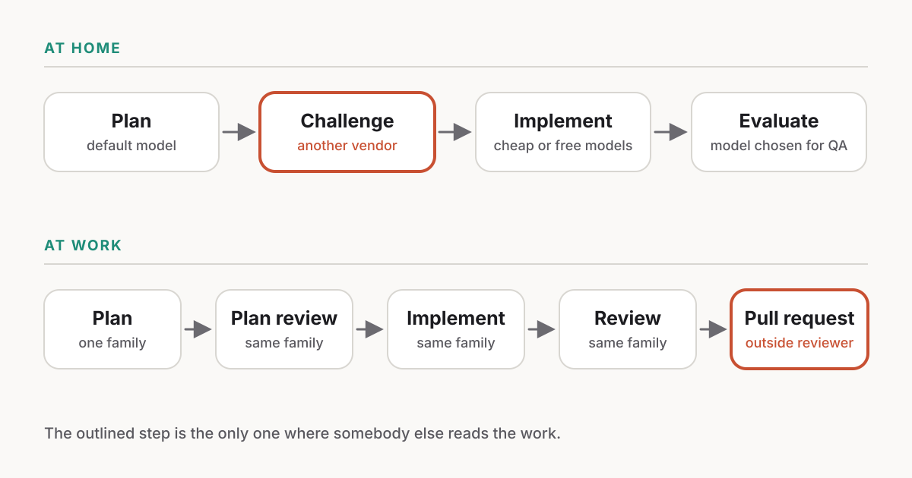

A few colleagues and I have been comparing how each of us works with coding agents, looking for ideas to take from each other.

Mine was this: at home, on personal projects, a second model challenges every plan before a line of code is written. At work, the flow I use every day does less of that, and its bug review was done by the session that wrote the code.

So I ran a plan challenge on this blog to see what one is worth, and I read my work skills the way I would read a colleague's pull request. The results of the challenge are below, with the prompt. The changes to the work flow went in this week, and no ticket has gone through them yet.



## The setup at home

At home I use Hermes Agent, from Nous Research. Its default model is Sol, from OpenAI, and I switch to Astra when a plan needs better output. I rarely let either of them implement.

Before anything sizeable gets built, Hermes writes a plan and hands it to a model from another vendor. It does this by running Claude Code in a terminal with a one-shot `claude -p` call, and Hermes ships a skill for that. Claude, on Anthropic's Opus or sometimes Fable, reads the plan and says what is wrong with it. Hermes revises. Then implementation goes to subagents on cheap or free models, which I reach through OpenRouter and OpenCode, and evaluation goes back to a stronger model.

The reasoning is about cost. A mistake in a plan takes a paragraph to fix, and the same mistake found in code review takes a rewrite.

## A plan challenge, run for real

I did not keep transcripts from Hermes, so I ran one on this blog. The request: show an estimated reading time on each post and next to each post in the lists. Sonnet wrote the plan. It noticed that most of the feature already existed and wrote 72 lines about closing the gaps.

A fresh Opus session then got the plan, the request and this prompt:

```text
Read PLAN.md and the files it cites. Do not rewrite the plan.
List what is wrong with it, most serious first. For each point give:
- the claim in the plan, quoted
- the file and line that contradicts it, or the case it forgets
- what would go wrong in production
Also list anything the plan does that the request never asked for.
If a section is fine, do not comment on it.
```

"Do not rewrite" stops the challenger from handing back a plan of its own, which somebody would then have to review. The file and line make each objection checkable.

It came back with eight points. Four of them, shortened:

```text
1. Step 4 adds the label to the timeline page, and a test asserts it
   in the built HTML. config.ts:14 sets showArchives to false, and
   archives/index.astro:13 redirects to /404. The step changes
   nothing anyone can see, and that test fails on every run.
2. Step 1 makes the helper return a number. Steps 3 to 5 pass it to
   a prop typed as string (Card.tsx:9) that is printed as is. Lists
   would show "· 3" with no unit. Nothing catches it: the build
   does not check types, and no test covers search.
4. The plan relies on build-output tests. CI runs lint, format check
   and build (ci.yml:31-38). It never runs npm test. Of the five
   checks, three already pass today and one can never pass.
7. Not requested: step 1 rewrites how the estimate is counted. That
   changes every number already shown on the site.
```

I checked all eight against the code and they held. On the first one, the plan cites lines 74 to 77 of the timeline page, and the redirect that makes the step pointless is on line 13 of that file.

I refused one sentence. The challenger wrote that an optional prop "keeps the failure that caused this request", and it cannot know what caused the request. The planner rules on each objection and gives a reason when it refuses one.

That run has a flaw: a stronger model reviewed a weaker one. So I ran it again with a fresh Sonnet session, same plan, same prompt. It found five of the eight, plus one Opus had missed: the plan's `npm run format` step would reformat untracked files that have nothing to do with the change. It missed the two most serious points, the disabled page and the number printed without its unit. It also raised one objection with no evidence behind it, which I dropped.

| Run                       | Tokens | Time  | Findings that held  |
| ------------------------- | ------ | ----- | ------------------- |
| Plan (Sonnet)             | 50,000 | 30 s  |                     |
| Challenge (Opus, fresh)   | 82,000 | 4 min | 8                   |
| Challenge (Sonnet, fresh) | 48,000 | 30 s  | 5 of those 8, 1 new |

One plan on one small repo proves little. What I take from it is that a fresh context alone catches a lot, a stronger model catches the worst, and neither run tells me anything about a second vendor, which is what my home setup actually uses.

## The flow at work

At work the flow is three Claude Code skills, running mostly on Opus. The first takes a ticket to a reviewed change in its own git worktree. The second is the review. The third opens the pull request, follows the comments and the CI, and cleans up after the merge. Copilot reviews the pull requests.

Tickets are sized by uncertainty, whatever the line count: small means one area and unambiguous acceptance criteria, and a single judgement call makes a ticket medium. Medium and large tickets get a written plan that I approve, and large ones have it reviewed first by a fresh subagent. Five gates (types, lint, format, tests, build) run from one script before any review starts. Every pull request body has a "Not verified" section naming what no check covered.

Most rules in those files carry a date, because each one was added after something went wrong. In October, two dev servers, two test runs and two headless browsers ran my 16 GB machine out of memory, so the scripts now refuse to start a second heavy job.

## Four gaps, and what I changed

The author reviewed its own code. The review ran three passes in parallel: one against the ticket, one against the repo's standards, one hunting for bugs. The first two went to fresh subagents, and the bug hunt stayed with the session that wrote the code, which knows why every line is there. A reviewer should not know that. The bug hunt now goes to a fresh subagent, and the writing session only rules on its findings.

The ticket was never questioned. The skill traced each acceptance criterion back to its source and did not ask what the ticket forgot. The agent now challenges the ticket before planning: what it leaves out, what contradicts the current code, which criteria nobody could check. [Matt Pocock's skills](https://github.com/mattpocock/skills) include one that grills the developer about a plan; this is that treatment moved one step earlier. A small ticket has no such gaps, and one that has them is no longer small.

Nothing kept count. Between the gates, the reviews and Copilot, I could not say which stage catches what, and the dated rules I like had only ever been added. Each stage now appends a row to a journal archived with the ticket:

```text
date | stage | source | severity | file:line | what | verdict | outcome
```

The source is whoever found it: a gate, a test, a review, Copilot, a human, the CI. The verdict is kept or dropped, and dropped findings are logged on purpose, since a reviewer whose findings mostly get dropped is noise. Comments on the pull request go in too, because they are what the earlier stages missed. The cleanup step reads the journal and may propose removing a rule.

I approved every commit and every push, on a one-line fix as on a new feature. In May I argued for [stopping the AI before every commit](/posts/gates-as-design-opportunities/), and I still hold that for architecture. A small, unambiguous ticket is a chore. It now goes to a draft pull request without asking me, only when all of this holds:

- the ticket was sized small
- every gate passed, and none was skipped
- no high or medium finding is left open
- "Not verified" is empty, apart from checks only the staging environment can settle
- every problem found and not fixed has its own ticket
- the change shows nothing on screen

The merge stays mine, and so does anything addressed to a person. Fix rounds are capped at two; a third means the plan or the ticket was wrong, and the agent stops and says which. I am loosening the stops before the journal has any data, which is a bet. The conditions are strict for that reason, and the journal records every comment those pull requests receive.

I am also trying one idea from [Superpowers](https://github.com/obra/superpowers), which runs each task of a plan in a fresh subagent with a review after each. When a plan has three or more independent tasks, each goes to a cheaper model, one at a time, and the main session reads every diff before the next starts.

## Why there is no second vendor at work

The fix from home would be a second vendor on the plan. [gstack](https://github.com/garrytan/gstack) has a `/codex` skill that asks OpenAI's Codex CLI for exactly that, and it was already in my skills folder. I am not turning it on, because my current subscription would not cover the usage. The table above shows the problem: a serious challenge can cost more than the plan it criticises. So the only reviewer outside my own sessions remains Copilot, and it arrives last, on the finished pull request.

Tokens are the constraint, so I filter what I can. [RTK](https://github.com/rtk-ai/rtk) is a proxy that trims the output of shell commands before the model reads it. Across 32,525 commands, its counter reports 13.4 million tokens saved, about 52%. Test and lint runs shrink by around 90% and file reads by less than 6%, so it pays most in a flow that runs gates often. I have not worked out whether that saving would fund a second vendor.

## Copy these first

- Challenge the plan before the code exists, in a fresh context.
- Ask for objections with a file and a line, and forbid rewriting.
- Let the planner refuse an objection, with a reason.
- Keep the session that wrote the code away from its own bug hunt.
- Log what every check catches, including what you dropped.

## Open questions

I do not know how much a second vendor adds over a fresh session of the same family. My example cannot say, and the journal will only hint at it through what Copilot catches late. The cheaper change would be to run the plan review on medium tickets as well as large ones. After seeing a thirty-second challenge find five real problems, I will probably make it.

Cheap implementers worry me more at work than at home, where the projects are small and the conventions are mine. And free models stay away from company code until somebody has read the terms, since some free tiers keep what you send them for training.

I might write the follow-up when the journal has a couple of months in it. If the numbers say a stage is useless, the follow-up will be about deleting it.
